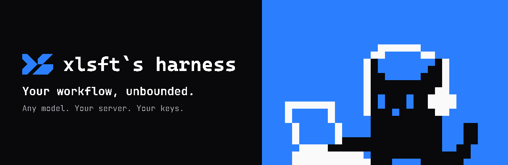
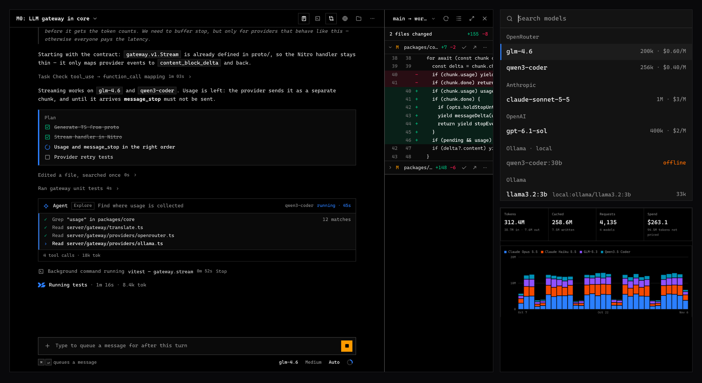

<p align="center">
  <a href="https://harness.xlsft.com"></a>
</p>

**xlsft\`s harness** is an open-source coding agent with the full feature set of the frontier labs' native harnesses. It works with any model, on a server you own, for one developer or a whole company. It has two parts: a **server** in one Docker container, and an **app** for macOS that runs the agent on your machine.

<p align="center">
  
</p>

[Every feature compared with the native harnesses](docs/comparison.md)

## Get started

Start the server:

```sh
docker run -d --name harness -p 3000:3000 -v harness-data:/data \
  -e HARNESS_PUBLIC_URL=http://localhost:3000 \
  -e HARNESS_ADMIN_EMAIL=you@example.com -e HARNESS_ADMIN_PASSWORD='a long password' \
  -e HARNESS_SECRET="$(openssl rand -base64 48)" \
  --stop-timeout 20 \
  ghcr.io/xlsft/harness:latest
```

[Download the app](https://github.com/xlsft/harness/releases/latest) for macOS, move it to Applications and sign in to your server. Add a provider under **Settings > Models** and start a session.

Coming from Claude Code? **Settings > Import** brings your configuration and sessions across, and `CLAUDE.md` and `AGENTS.md` are read as they are. <sub>xlsft\`s harness is independent and isn't affiliated with Anthropic. Claude Code is a trademark of Anthropic.</sub>

The app updates itself from **Settings > About**, and `harness-client update` updates a standalone client. Server upgrades, backups and the rest are in [`deploy/README.md`](deploy/README.md). Unless a release says it's notarized, macOS asks you to allow the first launch: [how](docs/release.md).

## Personal

- **Any model**: Anthropic, OpenAI, Gemini, xAI, DeepSeek, Kimi, GLM, OpenRouter, local models through Ollama or any OpenAI-compatible server. Switch per session
- **The subscriptions you already pay for**: connect an agent over [ACP](https://agentclientprotocol.com) and use your plan inside the app, with its limits in view

## Enterprise

- **LDAP**: sign-in with OpenLDAP or Active Directory, set up in **Settings > LDAP**, with test buttons for the connection and for a user lookup
- **Keys in one place**: provider keys stay encrypted on the server. Clients never get them; personal keys can't be read or used by admins
- **Limits and spend**: quotas per person, and tokens and cost per model and per user, with prices from a [public catalog](https://models.dev) or set by hand. No per-seat pricing
- **Your data stays with you**: sessions, files and history live on your infrastructure. With local models your code doesn't leave it, and `HARNESS_MODEL_PRICES=off` stops the one outside fetch the server makes for prices

## What it does

- **Tools**: `Read`, `Write`, `Edit`, `Glob`, `Grep`, `NotebookEdit`, `Bash`, `Monitor`, `Wait`, `LSP`, `WebFetch`, `WebSearch`, plus a browser, terminals, dev server previews and macOS computer use
- **Parallel work**: subagents (`Agent`, `SendMessage`) in worktrees of their own (`EnterWorktree`), scripted `Workflow`s, sessions that start and message each other
- **Planning and review**: plan mode, todos, `AskUserQuestion`, a changes pane against any base, line comments that go to the agent, rewind and fork
- **Pull requests**: status, CI and review comments wake the agent
- **Safety**: permission rules and modes, an auto mode backed by a classifier you choose, an OS sandbox for commands (Seatbelt on macOS) that each user can turn off
- **Extensible**: [MCP](https://modelcontextprotocol.io) servers with OAuth, agent definitions in Markdown, output styles, themes
- **Sync**: sessions and settings sync through your server, and the relay drives a running session from another device. Local agents, models and permissions stay on their device
- **Voice**: speech in and out, local or through a provider

## How it works

The agent loop and every tool run in the client, on your machine. The server never touches your code: it holds accounts, keys and sessions, and makes the model calls.

| Package | What | Stack |
|---|---|---|
| [`packages/core`](packages/core) | The server: LLM gateway, auth, sessions, relay | Node, [Nitro](https://nitro.build), SQLite |
| [`packages/client`](packages/client) | `harness-client`: agent loop, tools, permissions, sandbox | Go |
| [`packages/ui`](packages/ui) | The interface | [Nuxt](https://nuxt.com), [Nuxt UI](https://ui.nuxt.com) |
| [`packages/desktop`](packages/desktop) | The macOS app, with the client as a sidecar | [Tauri](https://tauri.app) |
| [`proto`](proto) | Contracts between them, over gRPC and Connect | [Buf](https://buf.build) |

The image bundles [SearXNG](https://github.com/searxng/searxng) for web search and [Garage](https://garagehq.deuxfleurs.fr) for object storage.

## Configuration

Providers, users, LDAP and search are set in the app. The server takes environment variables; the main ones:

| Variable | What |
|---|---|
| `HARNESS_PUBLIC_URL` | The URL clients and browsers use |
| `HARNESS_SECRET` | 32+ characters. Derives the auth secret and encrypts stored keys, so keep it |
| `HARNESS_ADMIN_EMAIL`, `HARNESS_ADMIN_PASSWORD` | The first admin |
| `HARNESS_ALLOW_SIGNUP` | Lets people register themselves |
| `HARNESS_TRUST_PROXY` | Set behind a TLS proxy |
| `HARNESS_MODEL_PRICES` | `off` stops the daily price fetch |

The full list is in [`deploy/README.md`](deploy/README.md).

## Verify a release

Images and `checksums.txt` are signed keylessly with [Sigstore](https://www.sigstore.dev) by this repository's release workflow, and carry SBOMs and SLSA provenance. A release runs only from a commit on `main` with green CI.

```sh
cosign verify ghcr.io/xlsft/harness:0.1.0 \
  --certificate-identity-regexp '^https://github.com/xlsft/harness/\.github/workflows/' \
  --certificate-oidc-issuer https://token.actions.githubusercontent.com
```

The rest is in [`docs/release.md`](docs/release.md#verifying-a-release).

## Development

[`CONTRIBUTING.md`](CONTRIBUTING.md) has the setup. `scripts/dev/stack.sh` runs the whole stack locally. Report vulnerabilities as [`SECURITY.md`](SECURITY.md) says.

## License

[MIT](LICENSE)
